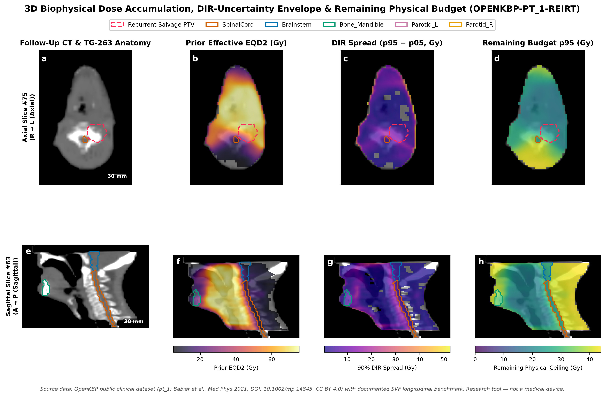
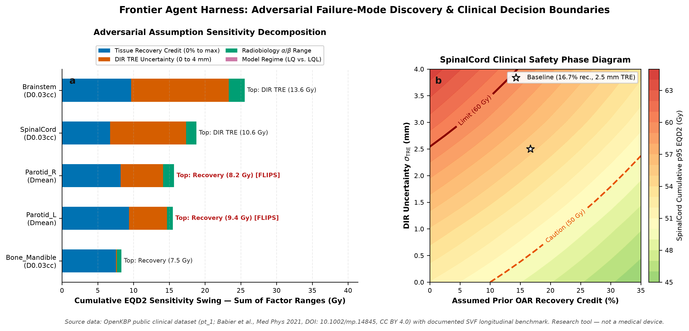
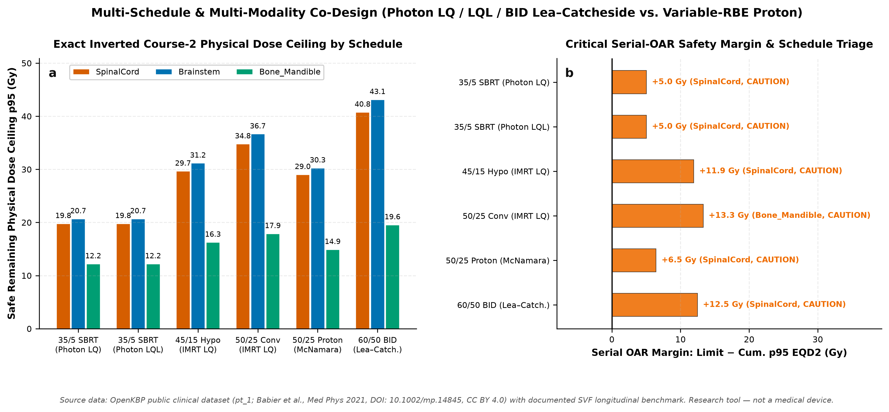

# `reirt-biobudget`

**3D Deformable Biophysical Dose-Accumulation, DIR-Uncertainty Envelope, and Inverse Remaining-Budget Engine with Frontier Agent Harness for Multi-Course Re-Irradiation**

> **Research & Clinical Safety Notice:** `reirt-biobudget` is academic research and educational medical physics software. **It is NOT a medical device** and is not cleared or approved for clinical decision-making.

---

## Why `reirt-biobudget`?

Multi-course re-irradiation is among the highest-risk workflows in modern radiotherapy (ESTRO/EORTC 2022). Standard clinical workarounds—naive rigid addition or single-point Excel EQD2 calculators—fail to capture **3D deformable image registration (DIR) uncertainty**, **multi-regime radiobiology** (high-dose SBRT LQL, protracted/BID Lea–Catcheside repair, distal-edge variable proton RBE), and **voxel-wise remaining safe physical dose headroom**.

Consumer AI chat interfaces cannot solve this problem reliably: they cannot ingest 3D DICOM-RT/volumetric arrays, they hallucinate biological equivalence formulas and coordinate frames, and they cannot enforce formal physical invariants. `reirt-biobudget` separates **deterministic physical ground truth** from **agentic clinical reasoning**:

1. **Proprietary Biophysical Core Engine (`src/reirt_biobudget/`)**
   - **Exact Forward & Analytical Inverse Multi-Regime Radiobiology (`radiobiology.py`)**: Standard LQ (Fowler 1989), $C^1$-continuous Linear-Quadratic-Linear (Astrahan 2008), Lea–Catcheside incomplete repair $G(\mu T) + h_m$ (Dale 1985), and closed-form analytical inverse McNamara variable proton RBE from 3D $\mathrm{LET}_d$ (McNamara et al. 2015). Machine-precision forward–inverse residual (`2.84e-14 Gy`).
   - **3D Diffeomorphic DIR-Uncertainty Envelope & AAPM TG-132 Forensics (`dir_envelope.py`)**: Stationary Velocity Field (SVF) scaling-and-squaring diffeomorphisms, physical-mm Jacobian determinant $J(\mathbf{x}) = \det(\mathbf{I} + \nabla\mathbf{u})$ & Inverse-Consistency Error (ICE) auditing, positivity-preserving trilinear dose warping, and TRE-calibrated 3D uncertainty envelopes ($p_{05}$, nominal, $p_{50}$, $p_{95}$, worst-case).
   - **3D Constraint-Safe Remaining Physical Dose Budget Optimizer (`budget_solver.py`)**: Inverts remaining OAR EQD2 headroom into exact 3D Course-2 physical dose ceilings $D_{\mathrm{rem}}(\mathbf{x})$, enforcing strict minimum across overlapping OARs and ESTRO/EORTC 2022 Type 1/2 classification.
   - **SHA-256 Provenance Ledger & Hard Abstention Gate (`provenance.py`)**: Refuses to output clinical numbers (`AbstentionError`) on missing `FrameOfReferenceUID`, non-diffeomorphic Jacobian folding ($J \le 0$), or excessive ICE ($> 5.0\ \mathrm{mm}$).

2. **Frontier Agent Harness & MCP Server (`src/reirt_biobudget/harness/`)**
   - **Closed-Loop Adversarial Assumption Sweeper (`agent_orchestrator.py`)**: Sweeps tissue recovery credit, DIR $\sigma_{\mathrm{TRE}}$, $\alpha/\beta$ epistemic bounds, and LQ vs. LQL regimes to identify the exact clinical tipping points and 2D safety phase boundaries (`PASS` / `CAUTION` / `VIOLATION`).
   - **Multi-Schedule & Multi-Modality Co-Designer**: Compares 6 candidate Course-2 schedules (SBRT LQ/LQL, Hypo-IMRT, Conv-IMRT, McNamara Variable-RBE Proton, BID Lea–Catcheside) head-to-head.
   - **Independent Critic-Verifier Gate**: Re-evaluates every numeric claim from first principles before emitting the ESTRO/EORTC 2022 Markdown dossier and JSON provenance ledger.
   - **JSON-RPC 2.0 MCP Stdio Server (`mcp_server.py`)**: Exposes 5 typed, provenance-gated physics tools for frontier agents (`reirt-biobudget mcp`).

---

## Publication-Grade Visual Results (Public OpenKBP Clinical Benchmark `pt_1`)

All benchmark figures below are computed on real de-identified head-and-neck IMRT anatomy and 3D clinical dose (`pt_1`, 70 Gy / 35 fx) from the open-access **OpenKBP** dataset (Babier et al., *Medical Physics* 2021;48:5549–5561, DOI: `10.1002/mp.14845`, **CC BY 4.0**), paired with an explicitly documented diffeomorphic SVF 18-month longitudinal follow-up benchmark.

### Figure 1 — Tri-Planar CT, Prior EQD2, 3D DIR Uncertainty Spread, and Remaining Physical Budget


### Figure 2 — Cumulative EQD2 DVHs with 90% DIR Uncertainty Envelopes & OAR Headroom


### Figure 3 — Frontier Agent Harness: Adversarial Sensitivity Tornado & 2D Safety Phase Diagram


### Figure 4 — Multi-Schedule & Multi-Modality Co-Design Matrix


### Figure 5 — AAPM Task Group 132 Deformable Registration Quality & Topology Forensics


---

## Quickstart

```bash
# 1. Create environment and install
uv venv --python 3.12 .venv
uv pip install --python .venv/bin/python -e ".[dev]"

# 2. Fetch real open-access OpenKBP clinical sample (CC BY 4.0, with SHA-256 manifest)
.venv/bin/python scripts/fetch_openkbp_sample.py --patient pt_1

# 3. Run full 3D engine + Frontier Agent Harness + 300-DPI academic figures
.venv/bin/reirt-biobudget run --patient-dir data/openkbp/pt_1 --out-dir outputs

# 4. Run full verification & audit test suite
.venv/bin/pytest -v tests/

# 5. Start JSON-RPC 2.0 MCP server for frontier agent harnesses
.venv/bin/reirt-biobudget mcp
```

---

## Verification, Audit & Documentation

- **Formal Mathematical Specification:** [`docs/ENGINE_SPECIFICATION.md`](docs/ENGINE_SPECIFICATION.md)
- **Independent Verification & Audit Report:** [`docs/AUDIT_REPORT.md`](docs/AUDIT_REPORT.md)
- **Generated ESTRO/EORTC 2022 Dossier:** [`outputs/reports/ESTRO_EORTC_ReIrradiation_Dossier.md`](outputs/reports/ESTRO_EORTC_ReIrradiation_Dossier.md)
- **Public Data Provenance, Licenses & BibTeX Citations:** [`DATA_SOURCES_AND_CITATIONS.md`](DATA_SOURCES_AND_CITATIONS.md)

---

## Key Citations

- Babier A et al. *OpenKBP: The open-access knowledge-based planning grand challenge and dataset.* Med Phys. 2021;48(9):5549–5561. DOI: `10.1002/mp.14845` (CC BY 4.0 / MIT)
- Andratschke N et al. *ESTRO/EORTC consensus on re-irradiation.* Lancet Oncol. 2022;23(10):e469–e478. DOI: `10.1016/S1470-2045(22)00447-8`
- Brock KK et al. *AAPM Task Group 132: Use of image registration and fusion in radiotherapy.* Med Phys. 2017;44(7):e43–e76. DOI: `10.1002/mp.12256`
- Mayo CS et al. *AAPM Task Group 263: Standardizing nomenclatures in radiation oncology.* IJROBP. 2018;100(4):1057–1066. DOI: `10.1016/j.ijrobp.2017.12.013`
- Nieder C et al. *Update of human spinal cord reirradiation tolerance.* IJROBP. 2006;66(5):1446–1449. DOI: `10.1016/j.ijrobp.2006.07.1383`
- Sahgal A et al. *HyTEC: Spinal cord dose tolerance to SBRT.* IJROBP. 2021;110(1):124–136. DOI: `10.1016/j.ijrobp.2019.09.038`
- Marks LB et al. *QUANTEC: Use of normal tissue complication probability models in the clinic.* IJROBP. 2010;76(3 Suppl):S10–S19. DOI: `10.1016/j.ijrobp.2009.07.1754`
- Astrahan MA. *Linear-quadratic-linear radiation dose-response with regard to hypofractionation.* Med Phys. 2008;35(9):4161–4172. DOI: `10.1118/1.2969065`
- Dale RG. *Application of the linear-quadratic dose-effect equation to fractionated and protracted radiotherapy.* BJR. 1985;58(690):515–528. DOI: `10.1259/0007-1285-58-690-515`
- McNamara AL, Schuemann J, Paganetti H. *Phenomenological RBE model for proton therapy.* PMB. 2015;60(21):8399–8416. DOI: `10.1088/0031-9155/60/21/8399`

---

## License

Apache License 2.0 (see [`LICENSE`](LICENSE)). Upstream OpenKBP data retains its original **CC BY 4.0 / MIT** license (see [`data/openkbp/ATTRIBUTION.md`](data/openkbp/ATTRIBUTION.md) and [`data/openkbp/UPSTREAM_LICENSE_OPENKBP.txt`](data/openkbp/UPSTREAM_LICENSE_OPENKBP.txt)).
