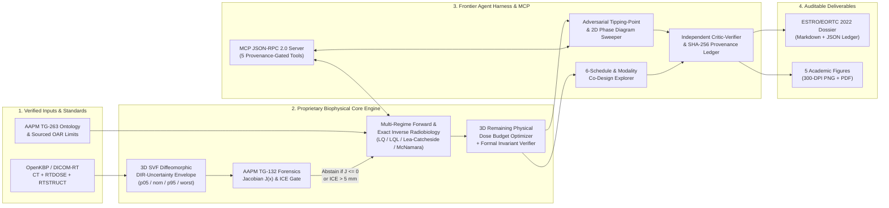
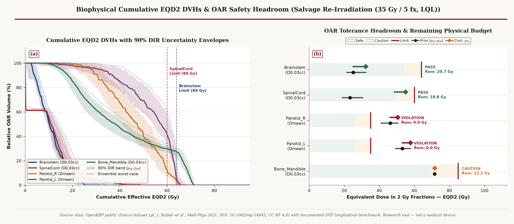
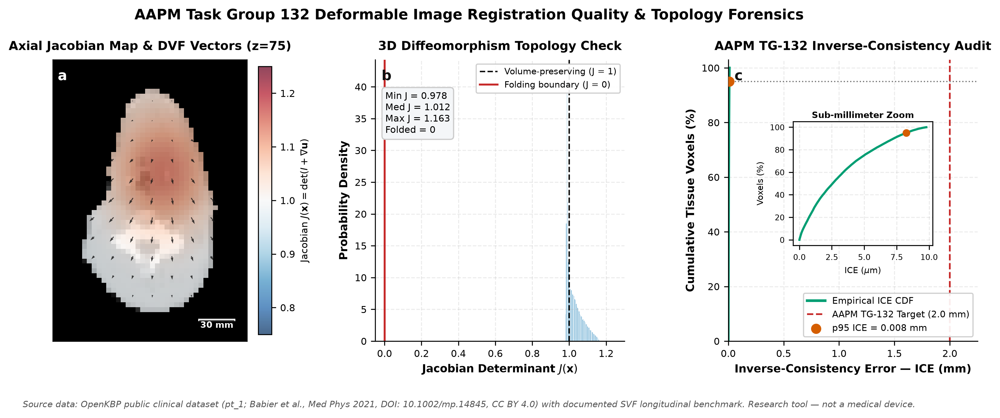

<div align="center">

# `reirt-biobudget`

### 3D Deformable Biophysical Dose-Accumulation, DIR-Uncertainty Envelope & Inverse Remaining-Budget Engine with Frontier Agent Harness

[](https://www.python.org/)
[](LICENSE)
[](tests/)
[](pyproject.toml)
[](docs/AUDIT_REPORT.md)
[](src/reirt_biobudget/harness/mcp_server.py)
[-546E7A?style=flat-square)](DATA_SOURCES_AND_CITATIONS.md)

<br>

[Architecture](#system-architecture) •
[Verified Benchmark](#verified-benchmark-dashboard) •
[Visual Gallery](#publication-grade-visual-results) •
[Quickstart](#quickstart) •
[DICOM-RT & MCP Usage](#workflows-cli-dicom-rt--mcp-agent-harness) •
[Audit & Citations](#verification-audit--citations)

</div>

---

> [!CAUTION]
> **Research & Educational Software — NOT A MEDICAL DEVICE.**
> `reirt-biobudget` has not been cleared or approved by the FDA, CE/MDR, or any regulatory authority for clinical diagnosis, treatment planning, or patient dose decision-making. Every clinical re-irradiation decision requires clinically commissioned software and sign-off by qualified radiation oncologists and board-certified medical physicists.

---

## Why `reirt-biobudget`?

Multi-course re-irradiation sits at the highest-risk intersection of modern radiotherapy (**ESTRO/EORTC 2022 consensus**). Existing clinical workarounds—naive rigid addition or single-point Excel EQD2 calculators—miss three dominant sources of error: **3D deformable image registration (DIR) uncertainty**, **multi-regime radiobiology** (SBRT high-dose LQL, protracted/BID incomplete repair, distal-edge variable proton RBE), and **voxel-wise remaining safe physical dose headroom**.

Consumer AI chat interfaces cannot solve this problem reliably: they cannot ingest 3D volumetric DICOM-RT grids, they violate coordinate/unit invariants, and they hallucinate biological equivalence formulas. **`reirt-biobudget` separates deterministic physical ground truth from agentic clinical reasoning**: the compiled/vectorized physics engine owns every number and invariant, while the **Frontier Agent Harness** orchestrates adversarial assumption sweeps, schedule co-design, and ESTRO/EORTC dossier auditing via typed **MCP** contracts.

---

## System Architecture



---

## Core Engine Capabilities

| Module | Proprietary Capability | Verification / Safety Guarantee |
| :--- | :--- | :--- |
| [`radiobiology.py`](src/reirt_biobudget/radiobiology.py) | Vectorized forward & **closed-form analytical inverse** across **LQ**, **$C^1$ LQL**, **Lea–Catcheside $G(\mu T)+h_m$**, and **McNamara variable proton RBE ($\mathrm{LET}_d$)** | Citardauq numerical stability; verified round-trip residual **`2.84e-14 Gy`** |
| [`dir_envelope.py`](src/reirt_biobudget/dir_envelope.py) | Scaling-and-squaring SVF diffeomorphisms, physical-mm $J(\mathbf{x})$ & ICE forensics, positivity-preserving trilinear dose warping, TRE-calibrated 3D envelopes | Strict quantile monotonicity $p_{05} \le p_{50} \le p_{95} \le \mathrm{worst}$; **0 folded voxels** |
| [`budget_solver.py`](src/reirt_biobudget/budget_solver.py) | Voxel-wise 3D Course-2 remaining physical dose ceiling $D_{\mathrm{rem}}(\mathbf{x})$, overlapping-OAR strict `min`, ESTRO/EORTC Type 1/2 classifier | Independent forward re-evaluation of every inverted budget voxel |
| [`provenance.py`](src/reirt_biobudget/provenance.py) | SHA-256 checksums over every 3D volume, DVF, and Pydantic spec + hard `AbstentionError` gate | Refuses execution on $J \le 0$, $\mathrm{ICE}_{p95} > 5\ \mathrm{mm}$, or missing/mismatched `FrameOfReferenceUID` |
| [`agent_orchestrator.py`](src/reirt_biobudget/harness/agent_orchestrator.py) & [`mcp_server.py`](src/reirt_biobudget/harness/mcp_server.py) | 4-axis adversarial assumption sweep, 2D safety phase diagram, 6-schedule co-design matrix, independent Critic-Verifier, JSON-RPC 2.0 MCP server | Every numeric dossier claim cross-checked against engine ledger before emission |

---

## Verified Benchmark Dashboard

Evaluated end-to-end on real de-identified clinical head-and-neck IMRT anatomy and 3D dose (**`OpenKBP pt_1`**, 70 Gy / 35 fx; Babier et al., *Medical Physics* 2021, DOI `10.1002/mp.14845`, **CC BY 4.0**) paired with a documented 18-month diffeomorphic SVF longitudinal follow-up (`35 Gy / 5 fx` LQL salvage candidate, $\sigma_{\mathrm{TRE}} = 2.5\ \mathrm{mm}$, $M = 24$):

| Audit Metric | Measured Value | Target / Standard | Status |
| :--- | :---: | :---: | :---: |
| **Forward–Inverse Radiobiology Residual** | `2.84e-14 Gy` | $\le 10^{-6}\ \mathrm{Gy}$ | PASS |
| **AAPM TG-132 Jacobian Determinant $J(\mathbf{x})$** | `[0.978, 1.163]` (`0` folded) | $J(\mathbf{x}) > 0$ everywhere | PASS |
| **AAPM TG-132 Inverse-Consistency Error ($\mathrm{ICE}_{p95}$)** | `0.0082 mm` (`8.2 μm`) | $\le 2.0\ \mathrm{mm}$ | PASS |
| **Independent Critic-Verifier Audit** | `0` discrepancies | All invariants verified | PASS |
| **Automated Test Suite (`pytest`) & Linter (`ruff`)** | `22 / 22` passed · `0` lint errors | 100% pass | PASS |
| **Key Clinical Finding (`SpinalCord` / `Brainstem`)** | DIR TRE swings `10.6` / `13.6 Gy` | Outstrips $\alpha/\beta$ & recovery | Surfaced automatically |

---

## Publication-Grade Visual Results

All figures are rendered at **300 DPI** (PNG + vector PDF) in radiological orientation with physical millimeter scalebars, colorblind-safe Okabe–Ito / perceptually uniform colormaps, and full source-data provenance footers.

### 1. Tri-Planar CT, Prior EQD2, 3D DIR Uncertainty Spread & Remaining Physical Dose Budget

*Axial (top, z=75) and sagittal (bottom, x=63) planes through the recurrent salvage PTV and cervical spinal cord: (a, e) follow-up CT with TG-263 OARs; (b, f) warped prior effective EQD2; (c, g) 90% DIR uncertainty spread highlighting high-gradient boundary risk; (d, h) exact inverted 3D Course-2 remaining physical dose ceiling $D_{\mathrm{rem},p95}(\mathbf{x})$.*

---

### 2. Uncertainty-Band Cumulative EQD2 DVHs & OAR Headroom

*(a) Cumulative effective EQD2 DVHs showing solid nominal curves, shaded 90% DIR bands $[p_{05}, p_{95}]$, dotted worst-case envelopes, and clinical serial OAR limits. (b) Per-OAR decomposition of prior effective EQD2 vs. cumulative Course 1+2 $p_{95}$ EQD2 and exact remaining physical dose headroom.*

---

### 3. Frontier Agent Harness: Adversarial Sensitivity Tornado & 2D Safety Phase Diagram

*(a) Multi-factor sensitivity decomposition across recovery credit, DIR TRE (0–4 mm), $\alpha/\beta$ epistemic range, and LQ vs. LQL regime. (b) 2D `SpinalCord` safety phase diagram mapping exact `Caution (50 Gy)` and `Limit (60 Gy)` clinical decision contours over assumed tissue recovery (%) and DIR uncertainty $\sigma_{\mathrm{TRE}}$ (mm).*

---

### 4. Multi-Schedule & Multi-Modality Co-Design Matrix

*(a) Exact inverted Course-2 physical dose ceilings for `SpinalCord`, `Brainstem`, and `Bone_Mandible` across 6 candidate schedules (Photon LQ/LQL SBRT, Hypo-IMRT, Conv-IMRT, McNamara Variable-RBE Proton, and BID Lea–Catcheside). (b) Critical serial-OAR safety margin triage.*

---

### 5. AAPM Task Group 132 Deformable Registration Quality & Topology Forensics

*(a) Axial Jacobian determinant map with overlaid DVF vector field. (b) 3D diffeomorphism topology histogram verifying zero folding ($J > 0$). (c) Inverse-Consistency Error empirical CDF with sub-millimeter inset zoom confirming $\mathrm{ICE}_{p95} = 8.2\ \mu\mathrm{m}$ vs. the 2.0 mm AAPM TG-132 threshold.*

---

## Quickstart

```bash
# 1. Clone and create Python 3.12 environment
git clone https://github.com/callmesobhan/reirt-biobudget.git
cd reirt-biobudget
uv venv --python 3.12 .venv
uv pip install --python .venv/bin/python -e ".[dev]"

# 2. Run the full 3D engine + Frontier Agent Harness + 5 academic figures (~15 s on CPU)
.venv/bin/reirt-biobudget run --patient-dir data/openkbp/pt_1 --out-dir outputs

# 3. Inspect any OAR's AAPM TG-263 normalization & sourced clinical constraints
.venv/bin/reirt-biobudget lookup spinal_cord

# 4. Run the full unit, DICOM-RT, abstention, and MCP audit suite
.venv/bin/pytest -v tests/
```

> [!TIP]
> Want to benchmark additional OpenKBP head-and-neck patients? Run:
> ```bash
> .venv/bin/python scripts/fetch_openkbp_sample.py --patient pt_2
> .venv/bin/reirt-biobudget run --patient-dir data/openkbp/pt_2 --out-dir outputs_pt2
> ```

---

## Workflows: CLI, DICOM-RT & MCP Agent Harness

<details>
<summary><b>1. Connect a Frontier AI Agent via MCP (Antigravity, Claude, Gemini CLI, Codex)</b></summary>

Add `reirt-biobudget` to your MCP client configuration to expose 5 deterministic, provenance-gated physics tools (`biobudget_lookup_tg263_oar`, `biobudget_compute_eqd2`, `biobudget_invert_remaining_dose`, `biobudget_compute_recovery_credit`, `biobudget_run_openkbp_investigation`):

```json
{
  "mcpServers": {
    "reirt-biobudget": {
      "command": "/absolute/path/to/reirt-biobudget/.venv/bin/reirt-biobudget",
      "args": ["mcp"]
    }
  }
}
```

</details>

<details>
<summary><b>2. Run on Anonymized Institutional DICOM-RT Exports (Python API)</b></summary>

```python
import numpy as np
from reirt_biobudget.io_loaders import load_dicom_rt_dose_and_structs
from reirt_biobudget.budget_solver import solve_reirradiation_budget
from reirt_biobudget.ir import CourseSpec, Modality, RadiobiologyModel

prior_dose, _ = load_dicom_rt_dose_and_structs("prior_rtdose.dcm")
_, oar_masks_c2 = load_dicom_rt_dose_and_structs("c2_grid_rtdose.dcm", "c2_rtstruct.dcm")

output = solve_reirradiation_budget(
    case_id="CASE_01",
    prior_course=CourseSpec(
        course_id="C1", label="Prior 60 Gy / 30 fx", n_fractions=30,
        prescription_gy=60.0, months_before_reirt=24.0,
        frame_of_reference_uid=prior_dose.frame_of_reference_uid,
    ),
    prior_dose=prior_dose,
    planned_course=CourseSpec(
        course_id="C2", label="Salvage 35 Gy / 5 fx LQL",
        modality=Modality.PHOTON, model=RadiobiologyModel.LQL,
        n_fractions=5, prescription_gy=35.0,
        frame_of_reference_uid="1.2.826.0.1.3680043.8.498.COURSE2",
    ),
    nominal_dvf_mm=np.load("registered_dvf_mm.npy"),
    oar_masks_course2=oar_masks_c2,
    tre_sigma_mm=2.5,
    n_ensemble=24,
)
remaining_ceiling_3d_gy = output.remaining_physical_p95_map.data
```

</details>

<details>
<summary><b>3. Repository Layout</b></summary>

```text
reirt-biobudget/
├── src/reirt_biobudget/
│   ├── ir.py                      # Typed Pydantic Physics IR & Volume3D containers
│   ├── ontology.py                # AAPM TG-263 normalizer & sourced clinical constraints
│   ├── radiobiology.py            # Forward & exact analytical inverse kernels (LQ/LQL/LC/McNamara)
│   ├── dir_envelope.py            # 3D SVF diffeomorphic DIR envelope & AAPM TG-132 forensics
│   ├── budget_solver.py           # 3D remaining physical dose ceiling optimizer & verifier
│   ├── provenance.py              # SHA-256 ledger & hard AbstentionError gates
│   ├── io_loaders.py              # OpenKBP (CC BY 4.0) & pydicom DICOM-RT loaders
│   ├── visualization.py           # 300-DPI academic PNG + PDF figure generator
│   ├── cli.py                     # CLI entrypoint (`run`, `lookup`, `mcp`)
│   └── harness/
│       ├── agent_orchestrator.py  # Adversarial sweeper, schedule matrix & Critic-Verifier
│       └── mcp_server.py          # JSON-RPC 2.0 MCP stdio server
├── tests/                         # 22 unit, DICOM-RT, abstention, OpenKBP & MCP tests
├── scripts/fetch_openkbp_sample.py
├── data/openkbp/                  # Verbatim OpenKBP pt_1 + ATTRIBUTION.md + upstream LICENSE
├── outputs/                       # Generated ESTRO/EORTC dossier, JSON ledger & 5 figures
└── docs/                          # ENGINE_SPECIFICATION.md & AUDIT_REPORT.md
```

</details>

---

## Verification, Audit & Citations

- **Formal Mathematical Specification:** [`docs/ENGINE_SPECIFICATION.md`](docs/ENGINE_SPECIFICATION.md)
- **Independent Verification & Audit Report:** [`docs/AUDIT_REPORT.md`](docs/AUDIT_REPORT.md)
- **Generated ESTRO/EORTC 2022 Dossier:** [`outputs/reports/ESTRO_EORTC_ReIrradiation_Dossier.md`](outputs/reports/ESTRO_EORTC_ReIrradiation_Dossier.md)
- **Complete Data Provenance, Licenses & BibTeX:** [`DATA_SOURCES_AND_CITATIONS.md`](DATA_SOURCES_AND_CITATIONS.md)

<details>
<summary><b>Peer-Reviewed References & BibTeX</b></summary>

1. **Babier A et al.** *OpenKBP: The open-access knowledge-based planning grand challenge and dataset.* Med Phys. 2021;48(9):5549–5561. DOI: [`10.1002/mp.14845`](https://doi.org/10.1002/mp.14845) *(CC BY 4.0 / MIT)*
2. **Andratschke N et al.** *ESTRO/EORTC consensus on re-irradiation.* Lancet Oncol. 2022;23(10):e469–e478. DOI: [`10.1016/S1470-2045(22)00447-8`](https://doi.org/10.1016/S1470-2045(22)00447-8)
3. **Brock KK et al.** *AAPM Task Group 132: Use of image registration and fusion in radiotherapy.* Med Phys. 2017;44(7):e43–e76. DOI: [`10.1002/mp.12256`](https://doi.org/10.1002/mp.12256)
4. **Mayo CS et al.** *AAPM Task Group 263: Standardizing nomenclatures in radiation oncology.* IJROBP. 2018;100(4):1057–1066. DOI: [`10.1016/j.ijrobp.2017.12.013`](https://doi.org/10.1016/j.ijrobp.2017.12.013)
5. **Nieder C et al.** *Update of human spinal cord reirradiation tolerance.* IJROBP. 2006;66(5):1446–1449. DOI: [`10.1016/j.ijrobp.2006.07.1383`](https://doi.org/10.1016/j.ijrobp.2006.07.1383)
6. **Sahgal A et al.** *HyTEC: Spinal cord dose tolerance to SBRT.* IJROBP. 2021;110(1):124–136. DOI: [`10.1016/j.ijrobp.2019.09.038`](https://doi.org/10.1016/j.ijrobp.2019.09.038)
7. **Marks LB et al.** *QUANTEC: Use of normal tissue complication probability models in the clinic.* IJROBP. 2010;76(3 Suppl):S10–S19. DOI: [`10.1016/j.ijrobp.2009.07.1754`](https://doi.org/10.1016/j.ijrobp.2009.07.1754)
8. **Fowler JF.** *The linear-quadratic formula and progress in fractionated radiotherapy.* BJR. 1989;62(740):679–694. DOI: [`10.1259/0007-1285-62-740-679`](https://doi.org/10.1259/0007-1285-62-740-679)
9. **Astrahan MA.** *Linear-quadratic-linear radiation dose-response with regard to hypofractionation.* Med Phys. 2008;35(9):4161–4172. DOI: [`10.1118/1.2969065`](https://doi.org/10.1118/1.2969065)
10. **Dale RG.** *Application of the linear-quadratic dose-effect equation to fractionated and protracted radiotherapy.* BJR. 1985;58(690):515–528. DOI: [`10.1259/0007-1285-58-690-515`](https://doi.org/10.1259/0007-1285-58-690-515)
11. **McNamara AL, Schuemann J, Paganetti H.** *Phenomenological RBE model for proton therapy.* PMB. 2015;60(21):8399–8416. DOI: [`10.1088/0031-9155/60/21/8399`](https://doi.org/10.1088/0031-9155/60/21/8399)

</details>

---

## License

Released under the **Apache License 2.0** (see [`LICENSE`](LICENSE)). Upstream OpenKBP sample data retains its original **CC BY 4.0 / MIT** license (see [`data/openkbp/ATTRIBUTION.md`](data/openkbp/ATTRIBUTION.md) and [`data/openkbp/UPSTREAM_LICENSE_OPENKBP.txt`](data/openkbp/UPSTREAM_LICENSE_OPENKBP.txt)).
